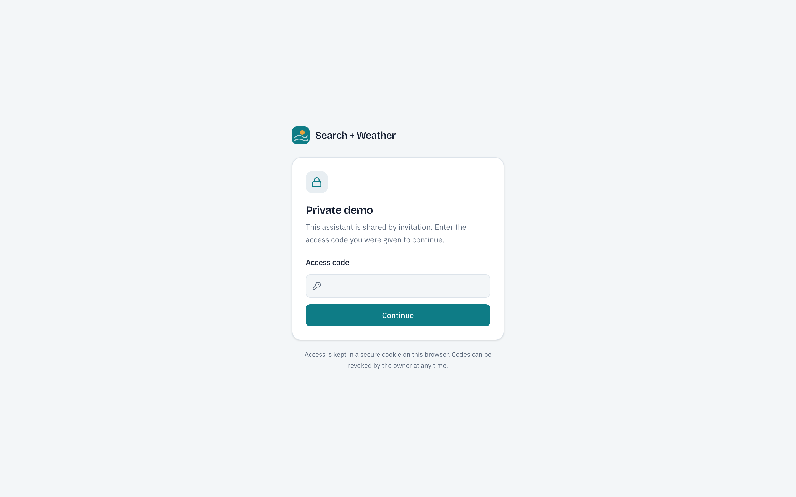
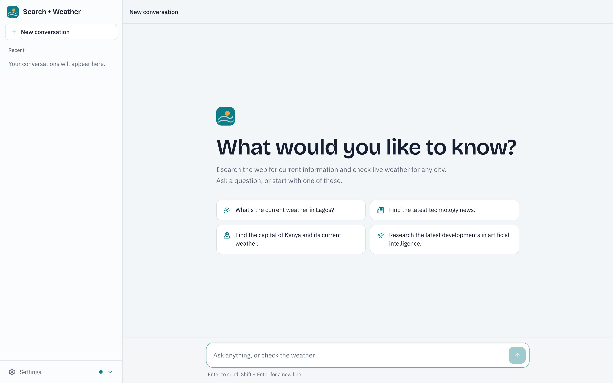
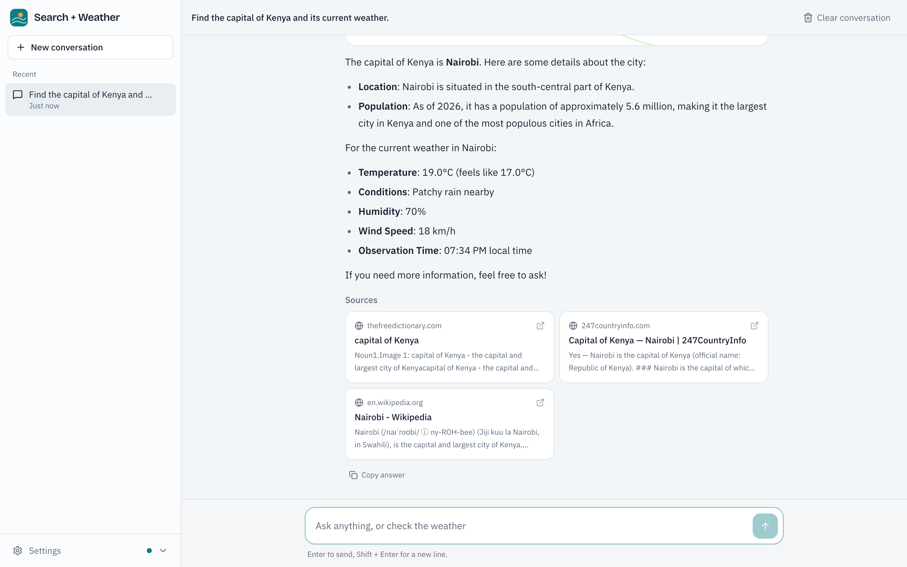
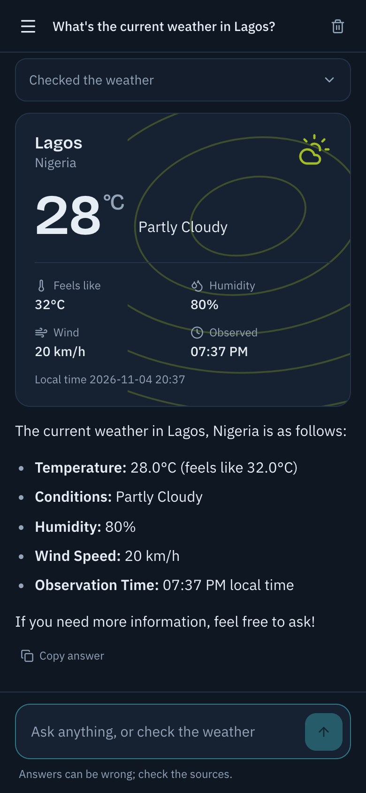
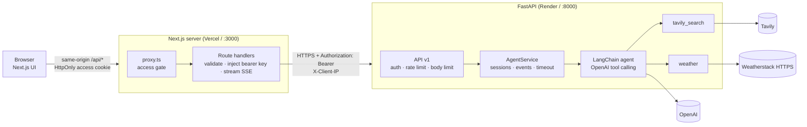

# Search + Weather Agentic AI Assistant

A full-stack AI assistant that answers questions using **live web search** and **current weather**. A LangChain tool-calling agent on a FastAPI backend decides when to search the web (Tavily), when to check the weather (Weatherstack), when to chain both, and when to answer directly. A Next.js interface streams the answer as it is written and shows each tool step as it happens.

It began as a single-file Streamlit demo (`app.py`, kept for reference) and was refactored into a tested, containerised application with a secure server-side proxy and an access gate for private demos.

| Access gate | Welcome |
|---|---|
|  |  |

| Multi-tool answer with sources | Weather card (mobile, dark) |
|---|---|
|  |  |

*Screenshots were captured from the Docker Compose stack in headless Chrome, with real OpenAI, Tavily and Weatherstack responses.*

## Features

- **Agentic tool use.** The model chooses between web search, weather and a direct answer, and chains tools for multi-step questions ("find the capital of Kenya and its current weather" → search → weather for Nairobi → one answer).
- **Streaming answers** over Server-Sent Events, with live activity: *Analyzing your request → Searching the web → Retrieving weather information → Preparing your answer → Completed*. Only safe execution events are shown, never model reasoning.
- **Structured results:** a weather card (location, temperature, conditions, humidity, wind, observation time) and source cards (title, domain, snippet, safe external link).
- **Honest failures.** Tool errors are structured, not invented; the agent says when a provider failed. Bounded execution (10 steps, 60 s per turn).
- **Conversations** with server-side session memory and browser-local history (labelled as stored in this browser only). Light and dark themes; responsive from phone to desktop.
- **Security by default.**
  - The browser only talks to the Next.js server.
  - Provider keys and the backend access key never reach the browser.
  - An optional access-code gate protects pages and API routes.
  - Rate limits, request-size limits and sanitized errors throughout.

## Architecture



| Layer | Responsibility |
|---|---|
| Browser | Chat UI. Calls only `/api/health`, `/api/agent/query`, `/api/agent/stream` and `/api/access` on its own origin |
| Next.js server | Access gate; validates requests (type, size, schema); adds `Authorization: Bearer <key>` server-side; forwards SSE unbuffered and aborts upstream on disconnect; sanitizes errors |
| FastAPI | Bearer-key auth, rate limiting, body limits, agent orchestration, SSE encoding, structured errors |
| Agent | `langchain.agents.create_agent` with native OpenAI tool calling, bounded steps and a per-turn timeout |
| Tools | Async Tavily and Weatherstack clients with timeouts, input validation and structured (Pydantic) outputs |

## Technology stack

| | |
|---|---|
| Frontend | Next.js 16 (App Router), React 19, TypeScript 5.9 (strict), Tailwind CSS 4, lucide-react, react-markdown |
| Backend | Python 3.11, FastAPI, Pydantic Settings, LangChain 1.x + langchain-openai, tavily-python, HTTPX, uvicorn |
| Tooling | uv (locked), npm (locked), pytest + respx, Ruff, mypy `--strict`, Vitest + React Testing Library, ESLint |
| Infra | Docker (multi-stage, non-root), Docker Compose, Render (backend), Vercel (frontend) |

## Agent workflow

1. The browser posts `{message, session_id}` to `/api/agent/stream`. The Next.js route checks access, validates the body and forwards it with the bearer key.
2. FastAPI authenticates the key, applies the rate limit and loads the session history (one turn per session at a time).
3. The agent receives the system prompt (`backend/app/agents/prompts.py`: tool guidance, "never fabricate tool results", today's date), the history and the message.
4. The model either answers directly or calls tools. Each call is streamed as `tool_start` → `tool_end`; the tool's structured result goes to the model and to the UI (weather or search data).
5. The loop ends with an answer, the step limit (10) or the timeout (60 s). The answer streams as `token` events; `done` carries the authoritative answer and every tool event.
6. Errors after the stream opens arrive as an `error` event. If the backend connection drops, the proxy adds a `stream_interrupted` error, so the browser always gets `done` or `error`.

SSE event order: `session`, `status(analyzing)`, any number of `[token* → tool_start → tool_end]` rounds, `status(preparing_answer)`, `token*`, and exactly one `done` or `error`. Full contract: [backend/README.md](backend/README.md).

## Tool integrations

| Tool (LLM name) | Provider | Input | Output | Failure handling |
|---|---|---|---|---|
| `tavily_search` | Tavily Search API (`AsyncTavilyClient`) | natural-language query | `{query, results: [{title, url, content, score}]}`; `TAVILY_MAX_RESULTS` (default 3) | empty results, timeout and provider errors become a structured `ok: false` result |
| `weather` | Weatherstack `/current` over **HTTPS only** (HTTPX) | city | city, country, region, °C, feels like, description, humidity, wind km/h, observation and local time | invalid city, unknown city, missing or HTTPS-restricted plan, timeout, malformed response → structured error; data is never fabricated |

Each provider has its own HTTP client (the Tavily SDK writes its bearer token into the client's default headers). Weatherstack URLs contain the key, so the HTTP client loggers are raised to WARNING, and every log line passes through a redacting formatter.

## Repository structure

```
backend/                FastAPI service (see backend/README.md)
  app/
    api/v1/routes/      agent.py, health.py, diagnostics.py (opt-in client-IP check)
    agents/             weather_agent.py (runner), prompts.py
    tools/              search_tool.py, weather_tool.py
    services/           agent_service.py, session_store.py
    schemas/            Pydantic request/response/event/tool models
    core/               config, logging, errors, rate limit, client IP, middleware
  tests/                unit/ and integration/ (pytest; live tests opt-in)
  Dockerfile  pyproject.toml  uv.lock  .env.example
frontend/               Next.js app (see frontend/README.md)
  src/proxy.ts          access gate
  src/app/api/          proxy route handlers + access routes
  src/server/           server-only config, proxy, SSE pass-through, gate
  src/components/ hooks/ lib/ types/
  Dockerfile  .env.example
docs/DEPLOYMENT.md      Docker, Render, Vercel, client IP verification, security operations
docs/screenshots/       README screenshots
research/agent-demo.ipynb  original exploration notebook (kept)
app.py, requirements.txt   original Streamlit app and its dependencies (kept for reference)
docker-compose.yml  render.yaml  .env.example  spec.md
```

## Prerequisites

- Python 3.11 and [uv](https://docs.astral.sh/uv/); Node.js 24 and npm. Docker Desktop (or Docker Engine with Compose v2) for the container setup.
- API keys:
  - [OpenAI](https://platform.openai.com/);
  - [Tavily](https://tavily.com/);
  - [Weatherstack](https://weatherstack.com/), on a plan **that supports HTTPS**: the backend refuses to send credentials over plain HTTP.

## Environment setup

| File | For | Contents |
|---|---|---|
| `backend/.env` (from `backend/.env.example`) | backend | `OPENAI_API_KEY`, `TAVILY_API_KEY`, `WEATHER_API_KEY`, `OPENAI_MODEL` (default `gpt-4o-mini`), `APP_ENV`, `FRONTEND_URL`, `LOG_LEVEL`, optional `API_ACCESS_KEY` and tuning |
| `frontend/.env.local` (from `frontend/.env.example`) | `npm run dev` | `BACKEND_API_URL`, `BACKEND_API_ACCESS_KEY`, optional `ACCESS_CODES`, `ACCESS_SESSION_SECRET` |
| `.env` (from `.env.example`) | Docker Compose | `BACKEND_API_ACCESS_KEY` (shared by both containers), optional access-gate variables |

All are git-ignored. None of the frontend variables are `NEXT_PUBLIC_`; they stay on the server. Generate secrets with `openssl rand -hex 32`, and access codes with `openssl rand -base64 18`.

## Local development

```bash
# Backend: http://localhost:8000 (Swagger at /docs)
cd backend
uv sync
cp .env.example .env            # add your keys
uv run uvicorn --factory app.main:create_app --reload

# Frontend: http://localhost:3000 (second terminal)
cd frontend
npm ci
npm run dev                     # proxies to http://localhost:8000 by default; the gate is off in development
```

If you set `API_ACCESS_KEY` in `backend/.env`, put the same value in `frontend/.env.local` as `BACKEND_API_ACCESS_KEY`.

## Docker

```bash
cp .env.example .env                    # BACKEND_API_ACCESS_KEY=$(openssl rand -hex 32)
cp backend/.env.example backend/.env    # provider keys
docker compose up --build
```

- Frontend http://localhost:3000. Backend http://localhost:8000, with Swagger at http://localhost:8000/docs and health at http://localhost:8000/api/v1/health.
- Ports are bound to `127.0.0.1`. The backend requires the bearer key (direct agent calls return 401), so use the UI or the proxy routes.
- Add `ACCESS_CODES` and `ACCESS_SESSION_SECRET` to `.env` to try the access gate.

Details: [docs/DEPLOYMENT.md §2](docs/DEPLOYMENT.md#2-docker-local).

## API

**Frontend (same-origin, what the browser uses):** `GET /api/health`, `POST /api/agent/query`, `POST /api/agent/stream`, `POST /api/access`, `POST /api/access/logout`. They require an access session when the gate is on. See [frontend/README.md](frontend/README.md#api-routes-same-origin).

**Backend (server-to-server):** interactive docs at `/docs`.

| Method and path | Auth | Description |
|---|---|---|
| `GET /api/v1/health` | none | `{"status":"healthy","service":"search-weather-agent","version":"1.0.0","environment":"…"}` |
| `POST /api/v1/agent/query` | Bearer (when `API_ACCESS_KEY` is set) | Complete answer: `{session_id, is_new_session, answer, tool_events[]}` |
| `POST /api/v1/agent/stream` | Bearer | SSE stream of the events above |
| `GET /api/v1/diagnostics/client-ip` | Bearer | Off by default (404). Verifies proxy headers after deployment |

Errors always use `{"error": {"code", "message"}}`: 401, 409 `session_busy`, 413, 422, 429 (with `Retry-After`), 500, 502, 504.

**Examples** (Docker stack; `KEY` is `BACKEND_API_ACCESS_KEY` from `.env`):

```bash
# Through the frontend proxy (as the browser does; gate off locally)
curl -s -X POST http://localhost:3000/api/agent/query -H 'content-type: application/json' \
  -d '{"message":"What is the weather in Lagos?"}'

curl -N -X POST http://localhost:3000/api/agent/stream -H 'content-type: application/json' \
  -d '{"message":"Find the capital of Kenya and tell me its current weather.","session_id":null}'

# Directly against the backend (needs the key)
curl -s -X POST http://localhost:8000/api/v1/agent/query -H "Authorization: Bearer $KEY" \
  -H 'content-type: application/json' -d '{"message":"Who is the president of Nigeria?"}'
```

## Testing

```bash
cd backend && uv run pytest && uv run ruff check . && uv run ruff format --check . && uv run mypy
cd frontend && npm test && npm run lint && npm run typecheck && npm run build
```

- **Backend:** unit and integration tests run with a scripted LLM and mocked HTTP (respx), so no credentials are needed. They cover tools, the agent, the service, SSE structure, configuration errors, auth, rate limiting, client-IP spoofing and the diagnostics endpoint. Live tests against real providers are opt-in: `uv run pytest -m live`, using `backend/.env`.
- **Frontend:** UI components and the chat flow run in jsdom. Route handlers, the SSE proxy and the access gate run in the node environment: split chunks, mid-stream failures, cancellation, status preservation, sanitization, size limits, token revocation and lockout.

Latest results are recorded in [spec.md](spec.md#15-final-verification-2026-11-04).

## Deployment

- **Backend → Render** (Docker, root directory `backend`, health check `/api/v1/health`, `render.yaml` Blueprint available).
- **Frontend → Vercel** (root directory `frontend`, server-only environment variables).

Step-by-step instructions, the client-IP verification procedure and gate operations are in **[docs/DEPLOYMENT.md](docs/DEPLOYMENT.md)**. Nothing has been deployed yet.

## Security considerations

- Secrets: provider keys live only in the backend; the proxy key and gate secrets only on the Next.js server. A build scan and a browser network audit confirmed nothing reaches the browser.
- Two independent gates:
  - The backend refuses to start in production without `API_ACCESS_KEY`.
  - A production frontend without access codes refuses every request.
- Access sessions use signed HttpOnly cookies, `SameSite=Lax` and `Secure` on HTTPS. Codes are revocable per person. Failed attempts are limited (see the limitations below).
- The client IP comes only from trusted sources: forwarding headers are honoured only from trusted proxy peers, and the end-user IP only with the backend key. `X-Forwarded-For` is never trusted.
- Inputs are validated twice (proxy and backend); sizes and agent steps are bounded; error responses never include internals; logs redact secrets.
- Containers run as non-root with read-only filesystems and no capabilities.

## Known limitations

- **In-memory state.** Sessions and rate limits live in one backend process, which must run as a single instance. Restarts (including Render free-tier sleep) clear them. Conversation history is stored per browser only.
- **Access-attempt limiting is per server instance.** It is exact in Docker, best effort on Vercel; strong codes are the real protection.
- **Render client-IP header is unverified** until checked on a deployed service ([procedure](docs/DEPLOYMENT.md#32-client-ip-on-render)).
- **Self-hosted frontends** (outside Vercel) have no trustworthy end-user IP, so the backend rate-limits proxied traffic as one client there.
- **Provider reliability.** Weatherstack calls occasionally failed during testing (a connection error, a timeout and an HTTP error in about a dozen calls). The tool reports these honestly but does not retry.
- **Free-tier cold starts** on Render can delay the first request by about a minute.
- **Not deployed.** Deployment steps are documented but have not been run.

## Research notebook and legacy app

[`research/agent-demo.ipynb`](research/agent-demo.ipynb) is the original exploration of a ReAct agent with Tavily search; it is preserved unchanged. It and the original Streamlit app (`app.py`) use the root `requirements.txt` (legacy, unpinned LangChain community packages) and need their own virtual environment. They read `OPENAI_API_KEY`, `TAVILY_API_KEY` (and, for `app.py`, `WEATHER_API_KEY`) through `python-dotenv`, which finds `research/.env` or the root `.env`. The root `.env` is also read by Docker Compose; extra variables there are harmless. They are not part of the new application, which replaces Streamlit with Next.js.
